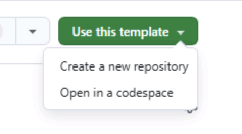

Antes de começar os exercícios do VS Code, prepare tudo. Você criará uma cópia do repositório Tailspin Toys, iniciará um [codespace][codespaces] para trabalhar e confirmará que o GitHub Copilot Chat está funcionando no editor.

## Configurar o repositório do laboratório

Crie uma instância a partir do [repositório de modelo][template-repository]. Ela conterá os arquivos necessários para o laboratório.

1. Em uma nova janela do navegador, acesse o [modelo do Tailspin Toys][tailspin-template].
2. Crie uma cópia do repositório selecionando **Use this template** na página do repositório e, em seguida, **Create a new repository**.

   

3. Se estiver participando de um evento conduzido pelo GitHub ou pela Microsoft, siga as instruções das pessoas mentoras. Caso contrário, crie o repositório em uma organização na qual você tenha acesso ao GitHub Copilot.

   

4. Anote o caminho do repositório criado (`organization-or-user-name/repository-name`), pois você precisará dele durante o laboratório.

> [!NOTE]
> **O backlog está pronto**
>
> Ao criar o repositório a partir do modelo, um backlog de issues do GitHub é criado automaticamente. Você trabalhará com essas issues durante o workshop; não precisa criar nenhuma.

## Criar um codespace

Em seguida, use um codespace para concluir os exercícios.

[GitHub Codespaces][codespaces] é um ambiente de desenvolvimento na nuvem que permite escrever, executar e depurar código diretamente no navegador. Ele oferece um ambiente de desenvolvimento integrado (IDE) completo com suporte a várias linguagens, extensões e ferramentas.

1. Acesse o repositório recém-criado.
2. Selecione o botão verde **Code**.

   

3. Selecione a guia **Codespaces** e o botão **+** para criar um codespace.

   

A criação do codespace pode levar alguns minutos, mas ainda é mais rápida do que instalar todos os serviços manualmente. Enquanto aguarda, explore outros recursos do GitHub Copilot.

> [!CAUTION]
> Você voltará ao codespace em um exercício futuro. Por enquanto, mantenha-o aberto em uma guia do navegador.

> [!NOTE]
> Este workshop foi criado para ser executado em um codespace ou em um [contêiner de desenvolvimento][dev-containers] local. Ambos fornecem os pré-requisitos necessários. Para trabalhar localmente, abra o repositório clonado no VS Code e selecione **Reopen in Container** quando solicitado. O VS Code criará o mesmo contêiner de desenvolvimento usado pelo codespace.

## Usar o GitHub Copilot Chat e o modo de agente

Para usar o modo de agente do GitHub Copilot Chat, instale a extensão GitHub Copilot Chat no IDE. Ela já deve estar instalada se você estiver usando um GitHub Codespace.

> [!TIP]
> Se a extensão não estiver instalada, [instale-a pelo Marketplace do Visual Studio Code][copilot-chat-extension]. Você também pode abrir a exibição Extensions no Visual Studio Code, pesquisar **GitHub Copilot Chat** e selecionar **Install**.

Depois de instalar a extensão, talvez seja necessário autenticar sua conta do GitHub.

1. Volte ao codespace.
2. Se o Copilot Chat não estiver visível à direita do editor, selecione o ícone **Copilot Chat** na parte superior do codespace.
3. Digite uma mensagem, como `Hello world`, na janela do Copilot Chat e pressione Enter.
4. Se for solicitado que você entre na sua conta do GitHub, siga as instruções de autenticação.

   

5. Depois da autenticação, a janela do Copilot Chat deverá aparecer.

## Resumo

Você criou uma cópia do repositório do laboratório e iniciou a criação do codespace que usará para desenvolver.

## Próxima etapa

Agora, comece a trabalhar com o Copilot. Continue em [Exercício 1: Instruções personalizadas][next-lesson] para apresentar as convenções do projeto.

## Recursos

- [Visão geral do GitHub Codespaces][codespaces]
- [Criar um repositório a partir de um modelo][template-repository]
- [Introdução ao Codespaces][codespaces-quickstart]

[tailspin-template]: https://github.com/github-samples/tailspin-toys
[template-repository]: https://docs.github.com/repositories/creating-and-managing-repositories/creating-a-template-repository
[codespaces]: https://github.com/features/codespaces
[codespaces-quickstart]: https://docs.github.com/codespaces/getting-started/quickstart
[dev-containers]: https://code.visualstudio.com/docs/devcontainers/containers
[copilot-chat-extension]: https://marketplace.visualstudio.com/items?itemName=GitHub.copilot-chat
[next-lesson]: ../1-custom-instructions/
