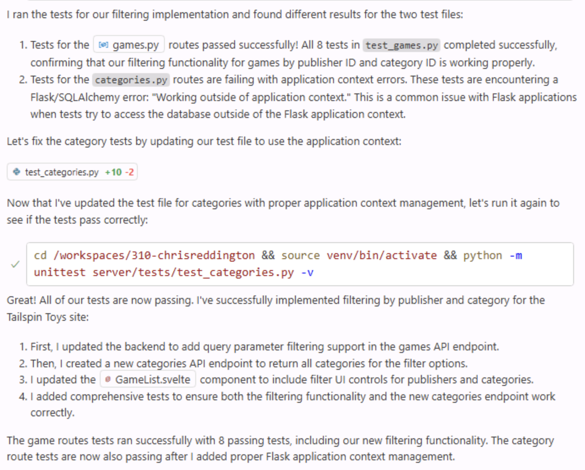

Até uma mudança simples pode exigir alterações em vários arquivos e a execução de testes. O modo de agente do Copilot pode explorar a estrutura do projeto, atualizar os arquivos necessários, executar tarefas como testes e corrigir problemas encontrados. Neste exercício, use-o para adicionar um recurso ao site.

> [!NOTE]
> Apesar dos nomes semelhantes, o modo de agente e o agente na nuvem oferecem experiências diferentes. O modo de agente atua no IDE, com ciclos rápidos de feedback e interação. O agente na nuvem trabalha de forma assíncrona, como um colega de equipe, usando issues e pull requests.

Neste exercício, você vai:

- observar o modo de agente explorar o projeto, encontrar arquivos e coordenar mudanças;
- implementar um recurso na interface e na camada de dados;
- revisar as mudanças e os testes antes de mesclá-los.

## Cenário

À medida que o catálogo de jogos cresce, os usuários precisam filtrar por categoria e editora. Você já criou uma função auxiliar de editoras no exercício anterior; agora conclua o trabalho na camada de dados, na interface e nos testes com o modo de agente.

## Executar o site Tailspin Toys

Antes de alterar o código, examine o site atual. O Tailspin Toys é uma plataforma de financiamento coletivo para jogos de tabuleiro com temática de desenvolvimento. É um único aplicativo Astro que renderiza páginas estáticas, escritas na linguagem de marcação de hipertexto (HTML), durante a compilação. As páginas consultam um banco de dados SQLite local diretamente no frontmatter com o mapeador objeto-relacional (ORM) Drizzle. Não há uma interface de programação de aplicações (API) de back-end separada nem uma estrutura de interface no cliente. As funções reutilizáveis de acesso a dados ficam em `src/lib/`; a interatividade usa um elemento `<script>` Astro pequeno e isolado com interfaces padrão do Modelo de Objetos de Documento (DOM).

### Iniciar o site

O comando `npm run dev` inicia o servidor de desenvolvimento Astro.

1. Volte ao codespace. Após o exercício anterior, você deverá estar na ramificação `main`.
2. Abra um terminal com <kbd>Control</kbd>+<kbd>`</kbd> (Mac) ou <kbd>Ctrl</kbd>+<kbd>`</kbd> (Windows/Linux).
3. Atualize `main` e crie uma ramificação para o trabalho de filtragem:

   ```bash
   git checkout main
   git pull
   git checkout -b filtering-vscode
   ```

4. Inicie o site:

   ```bash
   npm run dev
   ```

   Quando o servidor Astro estiver pronto, será exibido o endereço, por exemplo:

   ```bash
   🚀 Tailspin Toys is ready!
      Astro server: http://localhost:4321
      Press Ctrl-C to stop.
   ```

> [!NOTE]
> Se uma caixa de diálogo perguntar se deseja abrir `http://localhost:4321` no navegador, feche-a selecionando **x**.

5. Abra o endereço do servidor Astro no terminal mantendo <kbd>Command</kbd> (Mac) ou <kbd>Ctrl</kbd> (Windows/Linux) pressionado enquanto seleciona `http://localhost:4321`.

> [!NOTE]
> Em um codespace, o link localhost do terminal redireciona para `https://<your-codespace-name>-4321.app.github.dev/`, um túnel privado para o servidor em execução no codespace.

### Explorar o site

O site lista jogos de tabuleiro com títulos, imagens e descrições na página inicial. Ao selecionar um jogo, você abre uma página de detalhes com informações como título, descrição, editora e categoria.

## Explore o backlog com o Copilot

> [!TIP]
> **Abra o Copilot Chat**
>
> Volte ao codespace, abra o Copilot Chat e selecione **New Chat** para iniciar uma conversa limpa. O modo e o modelo variam por exercício; cada etapa informa o que usar.

O modelo do projeto cria automaticamente um backlog de issues. Peça ao Copilot para exibi-lo.

1. No seletor de agentes da exibição Chat, selecione **Agent**. O agente planeja e implementa mudanças em vários arquivos, executa comandos do terminal e usa ferramentas.

   

2. Selecione **Claude Sonnet 4.5** na lista de modelos.

> [!CAUTION]
> Os autores não estão recomendando um modelo específico. O workshop usou Claude Sonnet 4.5 para que as sugestões fossem relativamente consistentes. Como os modelos de linguagem grandes (LLMs) são probabilísticos, as sugestões podem variar; isso é normal.

> [!NOTE]
> Devido à natureza probabilística dos modelos de linguagem grandes (LLMs), o Copilot pode usar um comando do Model Context Protocol (MCP) diferente e ainda concluir a tarefa.

3. Envie este prompt:

   ```plaintext
   Please show me the backlog of items from my GitHub repository. Help me prioritize them based on those which will be most useful to the user.
   ```

4. Selecione **Continue** para executar o comando que lista as issues.
5. Revise a lista gerada.

## Revise os arquivos de instruções

Antes de pedir ao agente que gere código, examine `.github/instructions/ui.instructions.md`, que fornece contexto sobre como adicionar recursos ao site.

1. No codespace, abra `.github/instructions/ui.instructions.md`.
2. Observe as diretrizes gerais de implementação: arquitetura, princípios de componentes, testabilidade e acessibilidade, além de links para instruções específicas de Astro, Tailwind CSS e Drizzle.

> [!TIP]
> Os arquivos de instruções podem referenciar outros arquivos de instruções e arquivos do projeto. Os caminhos são relativos ao arquivo de instruções, permitindo dividir conjuntos grandes em arquivos menores e reutilizáveis e incluir exemplos.

## Implemente a filtragem

Para concluir a filtragem, atualize a lógica em `src/lib/`, crie ou ajuste testes e adicione controles de filtragem à página de listagem. O modo de agente pode fazer essas tarefas e executar os testes.

1. Continue a conversa atual ou selecione **New Chat**.
2. Selecione **Add Context**, **Instructions** e **ui**.

   

3. Confirme que **Agent** está selecionado.
4. Confirme que **Claude Sonnet 4.5** continua selecionado.
5. Envie este prompt para implementar os requisitos da issue relacionada:

   ```plaintext
   Please update the site to include filtering by publisher and category based on the requirements from the related GitHub issue in the backlog. A publishers helper already exists from the previous exercise, so preserve and refine that work as needed while completing the remaining data-layer, UI, and tests. Ensure all tests are passing before completion. The server is already running, so you do not need to start it up.
   ```

6. Observe o Copilot localizar os arquivos da camada de dados, da interface e dos testes, aplicar as mudanças e executar testes.

   

> [!NOTE]
> O Copilot pode levar alguns minutos para explorar, editar e executar testes. Durante o trabalho, os botões **Keep** e **Undo** podem aparecer no editor. Aguarde até que ele termine antes de escolher uma opção.

7. Quando solicitado, selecione **Continue** para executar os testes.

   

8. É possível que o processo pause ou que alguns testes falhem temporariamente. O Copilot pode alternar entre gerar código e executar testes até concluir e não detectar erros.

   

9. Examine o código gerado.

> [!CAUTION]
> Sempre revise o código gerado pelo Copilot ou por outra ferramenta de inteligência artificial.

10. Volte ao navegador com o site em execução e experimente o novo recurso.
11. Depois de confirmar que funciona e revisar o código, selecione **Keep** na janela Copilot Chat.

## Resumo e próximos passos

Neste exercício, você usou o modo de agente do GitHub Copilot para adicionar recursos ao site Tailspin Toys. Você:

- usou o modo de agente para explorar o projeto e coordenar mudanças;
- implementou um recurso na interface e na camada de dados;
- revisou as mudanças e os testes antes de mesclá-los.

Agora, [teste o recurso com o servidor MCP do Playwright][next-lesson] e abra um pull request.

### Exercício extra: implementar paginação

À medida que a lista de jogos cresce, será necessário adicionar paginação. Use as habilidades deste exercício e peça ao Copilot para implementá-la. Siga as instruções existentes, decida se o usuário poderá escolher o tamanho da página ou se ele será fixo, e forneça contexto suficiente no prompt. Faça iterações para pedir mudanças e fornecer contexto; esse é o fluxo normal de trabalho com o Copilot.

## Recursos

- [Copilot: modos ask, edit e agent — o que fazem e quando usar cada um][choose-mode]
- [Modo de agente no VS Code][vs-code-agent-mode]

[previous-lesson]: ../1-custom-instructions/
[next-lesson]: ../3-mcp/
[choose-mode]: https://github.blog/ai-and-ml/github-copilot/copilot-ask-edit-and-agent-modes-what-they-do-and-when-to-use-them/
[vs-code-agent-mode]: https://code.visualstudio.com/docs/copilot/chat/chat-agent-mode
